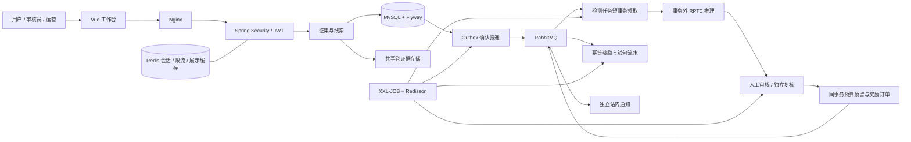

# 交通线索智能审核与激励平台

本项目面向校园/园区，闭环为“专项征集—上传线索—合成风险筛查—人工审核/独立复核—预算与奖励—通知与追踪”。AI提供风险分数，人工确定是否符合征集规则；不对接交管处罚。

| 层次 | 已使用的技术 | 具体职责 |
| --- | --- | --- |
| 后端基础 | Java21、Spring Boot4.1.2、Spring MVC、Jakarta Validation | 模块化单体、HTTP入口、参数/错误规范 |
| 安全 | Spring Security7.1.2、OAuth2 Resource Server、Nimbus JWT、BCrypt12 | 角色/权限/区域/资源归属，短访问令牌与可撤销会话 |
| 持久化 | MySQL8.0.32、MyBatis-Plus3.5.18、Spring JDBC、Flyway、HikariCP | 报告持久化、版本迁移、事务与行锁 |
| 会话与协调 | Redis6.2、Spring Data Redis、Lua、Redisson4.8.0 | 刷新轮换、限流、展示缓存、维护批次协调 |
| 异步 | RabbitMQ4.1、Spring AMQP、Outbox、Inbox、Confirm/Return、手动ACK | 可靠检测、幂等奖励、独立通知订阅、失败补偿 |
| 调度 | XXL-JOB3.4.2 | 补投、检测回收、审核转派、奖励/通知恢复、游标账务对账 |
| 文件 | EvidenceStorage端口、local与shared-volume适配器 | 服务端对象标识、PNG/JPEG校验、受权限保护的读取 |
| 模型 | Python3.12.7、Flask3.0.3、PyTorch2.9.1+cpu、Torchvision0.24.1+cpu、OpenCV4.11、NumPy/Pillow/SciPy | 原PatchCraft/RPTC权重、纹理块预处理、multipart推理协议 |
| 前端 | Vue2、Element UI、Axios、Vue CLI3/Webpack4、Node22构建 | 独立迁移入口，实际使用Vue2，未宣称升级Vue3 |
| 运维 | Docker Desktop/Compose、Nginx、Actuator、Micrometer/Prometheus、springdoc3.2/OpenAPI | 同源代理、健康/就绪、积压与维护指标、接口说明 |
| 验证 | JUnit5、真实HTTP/MySQL/Redis/RabbitMQ集成、Python unittest、Playwright/Edge | 并发/权限/故障恢复、真实模型和页面链路 |

数据库是预算和资金事实来源。审核终审同时预留预算，奖励消费同时更新订单/余额/流水；外部HTTP与MQ投递不持有数据库事务。Redis锁仅减少跨实例重复维护，数据库条件更新和唯一键仍保证业务效果幂等。

模块为identity、campaign、evidence、report、detection、review、reward、notification、operations、migration。先采用可运行的模块化单体，没有引入无业务依据的全套微服务、分库分表或ES。这里不包含真实支付、边缘设备部署、云厂商对象存储或自动违章定责；模型准确率未由本轮程序化样本测得。
