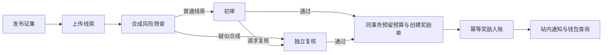

# 项目介绍与面试说明

项目名称：**交通线索智能审核与激励平台**。

面向校园、园区的交通线索处理场景，采用前后端分离和独立模型服务。介绍时先讲业务，再从权限安全、异步处理、奖励账务中选择两个方向展开，不必一次报完所有组件名称。

## 1. 一句话说明项目

这是一个把交通线索上报、图片合成风险筛查、人工审核和奖励发放串起来的平台，重点解决线索处理难追踪、权限边界不清，以及异常情况下奖励容易重复或超预算的问题。

## 2. 适合自我介绍的一分钟版本

> 我做的项目是交通线索智能审核与激励平台，主要面向校园和园区的交通线索管理。
>
> 业务上，运营人员先发布带有区域、时间和奖励预算的征集活动，用户上传线索图片。系统对图片进行合成风险筛查，再交给人工审核；疑似合成的线索进入独立复核，审核通过后按预算发放奖励，并记录进度和账务流水。
>
> 我主要围绕三个方面进行了设计和实现：一是用 Spring Security、JWT 和 Redis 完成多角色及区域权限控制；二是用 RabbitMQ 和事务 Outbox 实现异步检测、可靠消息及失败补偿；三是通过预算预留、唯一奖励订单和钱包流水，防止超预算和重复入账。
>
> 前后端使用 Spring Boot 和 Vue，模型通过 Flask 服务接入已有的 PatchCraft/RPTC 权重。目前完成了本地容器化部署和端到端验证，提现属于模拟结算。

口述时可以把技术部分缩短为“权限控制、可靠异步处理和奖励账务一致性”，等面试官追问后再说明对应技术。

## 3. 项目要解决的业务问题

| 问题 | 系统怎么处理 |
| --- | --- |
| 线索、图片和处理意见缺少统一记录 | 将征集、线索、检测任务、审核工单、通知关联起来，用户能查看进度 |
| 上传图片可能存在 AI 合成风险 | 集成合成图像检测模型，对高风险线索安排独立复核 |
| 不同人员的操作和数据范围不清 | 区分普通用户、初审员、复核员、管理员，并检查区域、归属和自审限制 |
| 模型调用慢，外部服务会失败 | 异步检测、超时控制、有限重试、死信隔离和维护任务补偿 |
| 并发审核或重复消息可能重复发奖 | 审核时预留预算并创建唯一奖励订单，消费入账时保证业务幂等 |

这些是本项目针对的设计问题，不代表已经在真实校园或企业上线运营。

## 4. 用一个例子讲清完整流程

下面是演示场景：北校区发布一项交通线索征集，预算 100 元，每条有效线索奖励 10 元。金额仅用于解释规则。

1. **运营发布征集。** 配置北校区、征集时间、奖励金额和总预算。
2. **用户提交线索。** 选择征集，上传图片、拍摄时间、地点和说明。线索继承征集的区域。
3. **后台异步检测。** 提交接口保存线索、检测任务和待发送事件；消息消费者再调用 Python 模型，用户无需等待模型完成才能收到提交响应。
4. **人工核验。** 普通线索进入初审；疑似合成线索进入独立复核。初审也可以主动请求复核。复核不能由此前参与该工单决议的人完成，用户也不能审核自己的线索。
5. **审核通过并预留预算。** 在同一数据库事务中保存终审结果、预留 10 元预算、创建唯一奖励订单和待发送事件。预算不足时整次终审回滚，保留工单，等待有权限的人员处理预算。
6. **奖励入账和通知。** 奖励消费者把预算占用转为支出，增加用户钱包余额并写入流水。通知通过独立订阅处理，用户可以查看结果。
7. **模拟提现与对账。** 提现申请先冻结余额，其他有权限的人员审批后模拟结算；维护任务对预算、奖励订单和钱包流水进行核对。

总体流程：

初审、复核还可以驳回线索，图中只展示奖励主流程。

### 谁使用这个系统

| 角色 | 职责 |
| --- | --- |
| 普通用户 `CITIZEN` | 提交线索、查询进度与奖励、申请模拟提现 |
| 初审员 `REVIEWER` | 领取初审工单、查看证据、通过或驳回、请求复核 |
| 复核员 `RECHECKER` | 处理疑似合成或转交的线索，完成独立复核 |
| 管理员 `ADMIN` | 管理征集、账户权限、预算、模拟提现审批及运维 |

“区域”是业务负责范围，例如北校区、南校区。**角色决定能做什么，区域决定部分业务操作可以在哪个范围内做**；具体操作还检查线索归属、工单领取状态等条件。账户管理和全局运维等功能另按功能权限控制。

演示账号中的 `traffic.bootstrap` 和 `traffic.manager` 都是 `ADMIN`，前者用于初始化且默认没有业务区域，后者绑定北校区；系统预设仍为四种角色。

## 5. 个人工作与三个技术亮点

可以介绍为：“我围绕线索处理流程，完成了新版前后端、模型服务接入、权限与审核、可靠异步任务、奖励账务，以及部署验证。”模型部分的工作是集成与服务化，原网络和权重沿用已有文件。

### 亮点一：权限同时控制功能、区域和资源归属

**实现效果：** 普通用户查看自己的线索与钱包；审核领取、证据读取、账务管理等操作按具体规则检查权限，退出登录、停用账号或修改权限后旧凭据不能继续使用。

**对应技术：** Spring Security、JWT、Redis、BCrypt 和 RBAC。JWT 验证签名和有效期，同时检查 Redis 会话、数据库用户状态及权限版本。刷新令牌使用原子轮换，密码采用 BCrypt 哈希。

**适合展开的问题：** “JWT 没过期，为什么注销以后也能失效？”回答重点是额外的服务端会话与权限版本校验，不是只依赖 JWT 的过期时间。

### 亮点二：耗时检测异步处理，异常后能恢复

**实现效果：** 用户提交不被模型推理阻塞；数据库提交成功但消息没有送达、消息重复到达、推理超时或消费者中断时，系统都有对应的恢复或隔离机制。

**对应技术：** MySQL 事务 Outbox、RabbitMQ 发布确认、手动 ACK、消费幂等、检测任务租约、版本校验与 XXL-JOB。

这里的 Outbox 是数据库中的待发送事件记录，和业务数据放在同一事务提交；投递失败后可以继续扫描补投。消费者完成业务事务后才确认消息，重复投递由业务幂等控制。

模型调用放在事务外，避免推理期间一直占用数据库事务和行锁。领取与提交结果分别使用短事务，通过领取凭证、版本和租约检查，拒绝过期执行结果覆盖当前状态。

**适合展开的问题：** “消息明明发送成功，为什么还可能重复？”例如消息已到达 RabbitMQ，但发布端尚未记录发送成功就中断，恢复后会再次发送，因此可靠投递还需要消费者幂等。

### 亮点三：发奖有预算约束，余额变化有流水依据

**实现效果：** 并发终审不能超过征集预算，同一条线索不能重复创建奖励订单，同一奖励不能因重复消息多次入账，奖励更正能追踪原记录。

**对应技术：** MySQL 事务、行锁、唯一约束、条件更新、预算预留和不可变钱包流水。审核通过与预算预留、奖励订单、Outbox 同事务；奖励消费中的订单状态、预算支出、余额与流水也同事务更新。

XXL-JOB 调度恢复和对账任务，Redisson 协调多个实例的维护批次；业务正确性仍由数据库约束和事务保护，不能只依靠 Redis 锁。

**适合展开的问题：** “奖励发错后直接改余额可以吗？”本项目保留原始入账流水，再追加更正流水或补偿单；余额不足时转人工处理，不制造负余额或虚构退款。

## 6. 技术栈怎么介绍

先介绍职责，面试官感兴趣时再补充组件名：

| 职责 | 技术 |
| --- | --- |
| 接口和业务实现 | Java 21、Spring Boot、Spring MVC |
| 身份认证与权限 | Spring Security、JWT、BCrypt、Redis |
| 数据持久化与版本管理 | MySQL、MyBatis-Plus、Spring JDBC、Flyway |
| 会话、限流、展示缓存和维护协调 | Redis、Lua、Redisson |
| 检测、奖励和通知的异步处理 | RabbitMQ、Outbox/Inbox、Spring AMQP |
| 补偿恢复和定期对账 | XXL-JOB |
| 操作页面 | Vue 2、Element UI、Axios |
| 已有模型的推理服务 | Python、Flask、PyTorch、PatchCraft/RPTC |
| 本地部署与观测 | Docker Compose、Nginx、Actuator、Micrometer/Prometheus、OpenAPI |

整体采用**模块化单体后端 + 独立 Python 推理服务**。Java 后端内部按身份、征集、证据、线索、检测、审核、奖励、通知和运维组织模块。项目规模下先保持部署和事务关系清晰，未拆成一套微服务。

## 7. 常见追问的简短回答

| 追问 | 回答要点 |
| --- | --- |
| AI 在这里识别什么？ | 筛查图片合成风险，提供风险分数；是否符合征集规则由人工审核，不直接自动判定交通违章 |
| PatchCraft 是自己训练的吗？ | 沿用已有网络和权重，完成服务封装、上传协议、异常处理和 Java 业务接入 |
| 为什么选择 RabbitMQ？ | 检测耗时且可能失败，奖励和通知也适合独立消费；MQ 使这些任务与提交请求分开，再配合可靠投递和幂等恢复 |
| Redis 故障时怎么办？ | 依赖会话校验的认证请求返回不可用，避免绕过校验；预算、余额和流水保存在 MySQL，故障恢复后再继续业务 |
| 独立复核有什么意义？ | 高风险或存在争议的线索由未参与此前决议的人重新处理，降低模型误判直接影响奖励的风险 |
| 怎么验证重复发奖等问题？ | 使用真实 MySQL、Redis、RabbitMQ 验证重复投递、并发预算、事务回滚和故障恢复，再核对账务流水 |
| 有什么可以继续完善？ | 补充有标注图片的模型评估；按实际部署需求完善推理服务运行方式与访问控制；依据压测结果再决定性能优化或服务拆分 |

## 8. 验证结果与介绍边界

2026 年 11 月 4 日的本机最终验收摘要记录：138 项 Java 测试、25 项 Python 协议测试、9 项浏览器检查通过，账务差异为 0，并验证了真实权重推理和应用重启恢复。证据见 [P8-final-summary.json](test-reports/P8-final-summary.json) 和 [重构执行记录](重构执行记录.md)。这些是已有验收记录，不表示编写本文时重新运行了全部测试。

介绍时准确区分：

- 本项目已完成本地容器化部署；没有交付边缘设备部署、云边协同或真实交管处罚对接。
- 模型提供合成风险信号；程序化样本验证了运行与协议，没有有标注数据集上的准确率结论。
- 当前激励包含预算、奖励、钱包流水和模拟提现，没有真实银行/支付接入；信誉分不属于新版已交付能力。
- 它是个人学习与重构项目，没有提供真实线上用户量、QPS 或业务收入数据。

技术实现细节与源码入口见 [架构与技术栈](架构与技术栈.md)、[P4 可靠检测设计](P4可靠检测设计.md)、[P5 审核复核设计](P5审核复核设计.md)、[P6 激励账务设计](P6激励账务设计.md)、[P7 调度运维设计](P7调度运维设计.md)。
